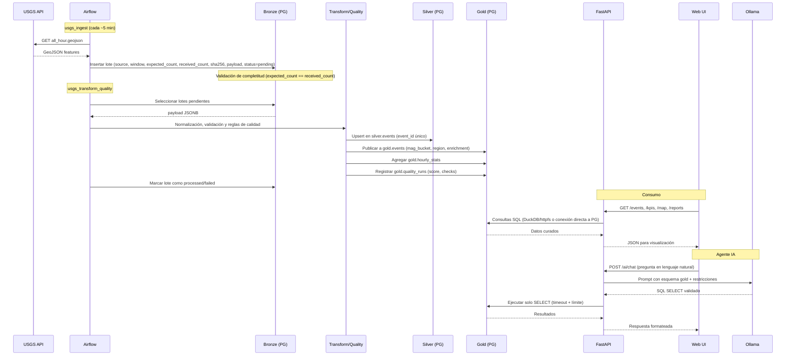

# SismoWatch

Plataforma de monitoreo sísmico en tiempo real con arquitectura **medallón** (Bronze / Silver / Gold) implementada sobre **PostgreSQL 16** (esquemas `bronze`, `silver` y `gold`). Complementada con **MinIO (S3-compatible)** como almacenamiento objeto para artefactos. Orquestada con **Apache Airflow**, expuesta mediante **FastAPI** con autenticación **JWT + RBAC**, visualizada con un frontend estático servido por **Nginx** y potenciada por un **agente IA local** con **Ollama + Qwen 2.5 Instruct**.

## Arquitectura General

```text
┌─────────────────────────┐
│ USGS Earthquake API     │
│ all_hour.geojson / FDSNWS│
└─────────────┬───────────┘
              │ HTTP GET
              ▼
┌─────────────────────────────────────────────────────────────────────────┐
│ Apache Airflow                                                           │
│ usgs_ingest → usgs_transform_quality → usgs_backfill → usgs_daily_report│
└─────────────┬───────────────────────────────────────────────────────────┘
              │ Inserción/transformación
              ▼
┌─────────────────────────────────────────────────────────────────────────┐
│ POSTGRESQL 16 - Arquitectura Medallón                                     │
│ ┌───────────┐   ┌───────────┐   ┌───────────────────────────────────┐   │
│ │ BRONZE     │ → │ SILVER     │ → │ GOLD                               │   │
│ │ bronze     │   │ silver     │   │ gold                               │   │
│ │ usgs_raw   │   │ events     │   │ events, hourly_stats, quality_runs,│   │
│ │ JSONB+audit│   │ limpio/tipo│   │ daily_reports, anomalies, ai_runs  │   │
│ └───────────┘   └───────────┘   └─────────────┬─────────────────────────┘   │
└─────────────────────────────────────────────────┼─────────────────────────┘
                                                  │ Consultas SQL
                                                  ▼
┌─────────────────────────────────────────────────────────────────────────┐
│ Consumo                                                                  │
│ FastAPI (JWT + RBAC) ──► PostgreSQL (schemas bronze/silver/gold)        │
│           │                                                              │
│           ├──► Nginx + Web UI (Dashboard / Mapa / Reportes CSV-PDF)    │
│           └──► Ollama + Qwen 2.5 (NL → SQL SELECT sobre gold)          │
└─────────────────────────────────────────────────────────────────────────┘

                ┌─────────────────────────────────────────────┐
                │ MinIO (S3-compatible) - Complementario      │
                │ Almacenamiento objeto para artefactos/raw   │
                │ / soporte al patrón Data Lake               │
                └─────────────────────────────────────────────┘
```

## Diagrama de Flujo de Datos

### Flujo Operativo (Tiempo Real / Por DAG)



### Flujo Detallado por Capas

| Etapa | Responsable | Entrada | Salida | Validaciones |
| --- | --- | --- | --- | --- |
| **Ingesta** | DAG `usgs_ingest` | `all_hour.geojson` desde USGS | `bronze.usgs_raw` (JSONB + metadatos) | Conteo esperado vs recibido, hash SHA256, idempotencia por ventana/payload |
| **Backfill Histórico** | DAG `usgs_backfill` | Ventanas temporales vía FDSNWS | `bronze.usgs_raw` | Validación de completitud por lote, reintentos controlados |
| **Transformación** | DAG `usgs_transform_quality` | Lotes `pending` en Bronze | `silver.events` | Normalización de campos, tipado, deduplicación por `event_id` |
| **Calidad** | DAG `usgs_transform_quality` | Datos en proceso | `gold.quality_runs` | Reglas de calidad, cálculo de score, trazabilidad por `bronze_id` |
| **Curación** | DAG `usgs_transform_quality` | `silver.events` | `gold.events`, `gold.hourly_stats` | Enriquecimiento (bucket magnitud, región), agregados horarios |
| **Reporte Diario** | DAG `usgs_daily_report` | `gold.events` | `gold.daily_reports`, `gold.ai_runs` | Generación con IA o fallback, registro de métricas de IA |
| **Consulta** | FastAPI + DuckDB | Solicitudes REST | Respuestas JSON/CSV/PDF | Autenticación JWT, autorización por rol, límites de consulta |

## Servicios y Puertos

| Servicio | Puerto | Descripción |
| --- | --- | --- |
| **Web (Nginx)** | `3000` | Frontend estático con dashboard, mapa Leaflet, reportes y chatbot IA |
| **API (FastAPI)** | `8000` | REST API, autenticación JWT, agente IA NL→SQL, Swagger en `/docs` |
| **Airflow Webserver** | `8086` | Orquestación de DAGs, monitoreo de ejecución, administración |
| **PostgreSQL** | Interno (`5432`) | Base de datos principal con schemas `bronze`/`silver`/`gold` y metadatos de Airflow |
| **MinIO API** | `19000` | Almacenamiento S3-compatible para artefactos/raw |
| **MinIO Console** | `19001` | Consola web de administración de buckets |
| **Ollama** | Interno (`11434`) | Servidor de modelos IA local (Qwen 2.5 Instruct) |

## Puesta en Marcha

```bash
# Clonar y configurar
cp .env.example .env  # Ajustar credenciales si es necesario

# Levantar stack completo
./start
```

El script `start` valida variables de entorno, construye y levanta todos los contenedores con `docker compose`, configura buckets en MinIO, realiza una ingesta inicial desde USGS y muestra las URLs de acceso.

## Uso Rápido

1. Abrir [http://localhost:3000](http://localhost:3000) - Tablero principal
2. Iniciar sesión con credenciales definidas en `.env` (`ADMIN_USER` / `ADMIN_PASSWORD` o `VIEWER_USER` / `VIEWER_PASSWORD`)
3. Abrir [http://localhost:8086](http://localhost:8086) y activar los DAGs: `usgs_ingest`, `usgs_transform_quality`, `usgs_backfill`, `usgs_daily_report`
4. Ejecutar `usgs_backfill` con `{"days": 1}` para cargar datos históricos de prueba
5. Recargar el tablero para visualizar KPIs, mapa interactivo, eventos sísmicos y utilizar el chatbot IA

## Roles y Permisos (RBAC)

| Rol | Permisos |
| --- | --- |
| `viewer` | Dashboard, visualización de eventos, reportes (CSV/PDF), monitoreo en tiempo real, resumen de pipeline |
| `admin` | Todos los permisos de viewer + detalle de pipeline, acciones administrativas (backfill/regenerar), acceso completo a funcionalidades |

## Seguridad

- **Autenticación**: JWT con algoritmo HS256, expiración configurable mediante `JWT_MINUTES` (por defecto 480 min)
- **Autorización**: Control basado en roles (`admin`/`viewer`) a nivel de endpoint
- **Principio de mínimo privilegio**: `ingest_user` (bronze), `transform_user` (bronze/silver/gold), `reader_user` (solo lectura en gold con `default_transaction_read_only=on`, timeout de 8s)
- **Agente IA**: Restricciones estrictas - únicamente consultas `SELECT`, solo sobre esquema `gold`, sin DDL/DML, con validación de sintaxis y límite de filas
- **Trazabilidad**: Cada lote en Bronze incluye hash SHA256, conteo esperado/recibido, estado y timestamps; ejecuciones registradas en `gold.ai_runs` y `gold.quality_runs`

## Tecnologías

| Categoría | Tecnologías |
| --- | --- |
| **Almacenamiento** | PostgreSQL 16, MinIO (S3-compatible) |
| **Formato de Datos** | JSONB (Bronze), Parquet/relacional tipado (Silver/Gold) |
| **Orquestación** | Apache Airflow (LocalExecutor) |
| **Backend** | FastAPI, Uvicorn, Pydantic, PyJWT |
| **Consulta Analítica** | DuckDB con `httpfs` / SQL nativo sobre PostgreSQL |
| **Frontend** | HTML5, CSS3, JavaScript vanilla, Leaflet.js |
| **IA Local** | Ollama, Qwen 2.5 Instruct (7B) |
| **Contenedorización** | Docker, Docker Compose, Nginx |
| **Calidad de Datos** | Reglas de validación, scoring, trazabilidad por lotes |
